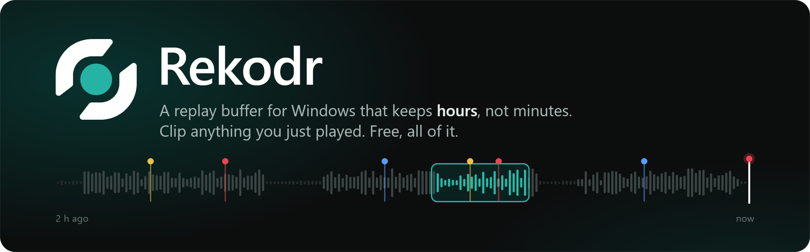

# Rekodr

A replay recorder for Windows. It records your screen all the time, so when something happens you press a key
and keep it.

Rekodr is in beta: things may change between versions.

## What it does
- **Hours of replay.** The buffer is on disk, not in memory, so it holds hours, not minutes.
- **Every app's sound on its own track.** Game, voice chat and music stay separate, to mix or mute later.
- **Clips and sessions.** Alt+F6 (or a Stream Deck key) saves the last stretch as a clip, and whole game
  sessions are kept to look back through.
- **Editor.** Quick cuts, or an advanced editor with tracks. Edits never change the original.
- **Share.** One click gives a file sized to fit, or a link through your own Cloudflare R2 bucket or a ShareX
  uploader.
- **Auto markers.** Kills and other moments in Counter-Strike 2 and League of Legends are marked as they happen.
- **Free.** Every feature, for everyone.

Game names and art come from Discord's public list of games, Steam's images and Rekodr's own service, rekodr-api.

## Install
Run `rekodr-setup.exe`. It installs for your Windows account only, with no admin prompt, and starts with
Windows. The installer isn't signed yet, so Windows SmartScreen may warn: click **More info**, then **Run anyway**.

Rekodr updates itself. It checks each new version's signature and asks before restarting into it, and if a new
version crashes in its first minute, it goes back to the one before. Uninstall it from Windows Settings > Apps.

It needs Windows 10 or 11. If it finds no ffmpeg 7 or later, it downloads a pinned build (FFmpeg 8.1.1, GPL) on
first start.

## Build
With Visual Studio's C++ build tools:
```
app\build.bat     # builds app\build\rekodr.exe
app\test.bat      # builds and runs the tests
```
The whole program is one translation unit, `app\rekodr.cpp`, which includes every other file in `app\`. With
`REKODR_HOME` set to a folder, Rekodr runs as a separate copy that keeps everything under that folder.
[SPEC.md](SPEC.md) describes what Rekodr does and how it is built.

## Commands and Stream Deck
`rekodr.exe <command>` passes a command (`save 30s`, `mark`, `toggle`, `open`, `quit`) to the running copy.
Programs on the same PC can send the same commands over a named pipe. [SCRIPTING.md](SCRIPTING.md) lists them.

`streamdeck\dev.calvbot.rekodr.sdPlugin` is a Stream Deck plugin with keys that save a clip, turn recording on
and off, and open the window. `node streamdeck\pack.mjs` builds it.

## Files
Settings are kept in `%APPDATA%\Rekodr`. The log, crash dumps and the game art cache are in
`%LOCALAPPDATA%\Rekodr`. Clips and sessions are saved in `<Videos>\Rekodr` unless Options says otherwise.
